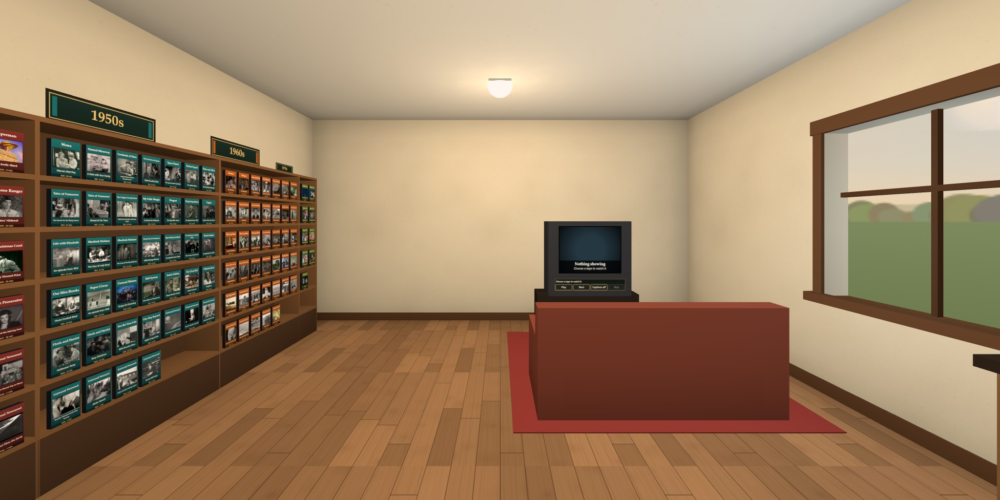

# video

**https://ariamokr.github.io/video/**

A room behind one of the [Hallway](https://ariamokr.github.io/hallway/)'s doors to watch old TV in,
alone or together: public-domain shows from archive.org's
[Classic TV](https://archive.org/details/classic_tv) collection, newsreels from its
[Universal Newsreels](https://archive.org/details/universal_newsreels), films from the
[Prelinger Archives](https://archive.org/details/prelinger), and silent comedies of the 1920s and
cartoons of the 1920s and 1940s, on tapes on the shelves, played on the room's screens. The room can be a video store, a den, a screening room or a gallery
of TV sets. Watch in VR on a Meta Quest, on a desktop or on a phone. There is nothing to install.



Behind you as you come in is the doorway you came through, glowing sky blue, with the Hallway seen
through it. Walk back through it (or click or tap it, or point at it in VR and pull the trigger) and
you are back in the Hallway, in front of this room's door. On the wall either side of it are two panels:
facing the doorway, the control panel on the left, and the room's own on the right (which room it
is, how its tapes are shelved, and what is showing). The room itself is [RoomTemplateEmpty](https://github.com/AriaMoKr/RoomTemplateEmpty)'s: a
floor, four walls, a ceiling with its lamps and a window onto the afternoon sky in the right-hand
wall.

## The four rooms

The same room, furnished four ways. Choose one on the room's panel by the doorway, or under
**Room** in the card at the top left. The choice is kept in this browser (`localStorage`, under
`video.room`), and `?mode=store` (or `den`, `screening`, `gallery`) in the address picks one for
that visit. The first visit is the video store.

| Room | What is in it |
|---|---|
| **Video store** | Every tape face out on shelves down the left wall, a bay to each decade (or category) under its sign, a counter by the doorway, and a TV and a couch at the back. |
| **Den** | A console TV against the far wall, a sofa and a coffee table on a rug, and the tapes on shelves. |
| **Screening room** | A screen across the far wall over a low stage, three rows of seats on either side of an aisle, and the tapes round the way in: on the doorway's wall and down both sides. While a show plays, the lights go down and the window's curtains close. |
| **Decades gallery** | A TV set from each decade, styled for its time, from a 1920s televisor on a table to a 1970s set on its cart, each showing that decade's shows (a still from each in turn). Using one plays what it shows. |

Each tape's sleeve is in its decade's colour, and made the way its kind was shown: a TV show on a
television set's glass, a silent film as an intertitle with its picture in an oval, a cartoon in a
ring on a sunburst, a short film as a frame on a strip of film, a newsreel as a newspaper's front
page. Along its foot are its kind, its year and how long it runs. On the shelves each decade's
tapes stand in that order: its television, then its silent films, cartoons and short films, then its
newsreels.

The shelves can instead be by category: a bay to each, Television, Silent films, Cartoons, Short
films and Newsreels, its sign with its icon either side, and in each the decades in order, so the
sleeves' colours run from the 1920s to the 1970s. In the screening room the few silent films and
cartoons are then on the doorway's wall, the television down the left, and the short films and
newsreels on the right. Choose **By decade** or **By category** under **Shelves** on the room's
panel or in the card (not in the gallery, which has no shelves). The Episodes list in the card is
grouped the same way, and **Next** plays the next tape along the shelves. The choice is kept with
the room's, and `?shelving=kind` (or `decade`) picks one for a visit. In a shared session everyone
sees the same shelves.

## Watching

- **Choose a tape**: click or tap it, point at it in VR and pull the trigger, or put the dot on it
  and press A (a gamepad) or OK (a TV remote). The room's screen plays it, with its name and the
  time on the room's panel. The card's **Episodes** lists every episode too, for a keyboard or a
  screen reader: by decade, and in each by kind, under its name and an icon drawn like its tapes
  (or, with the shelves by category, by kind and in each by decade).
- **Under the screen** is a bar of buttons: Play or Pause, Next (the next tape on the shelves),
  Captions, Stop. The room's panel and the card have the same.
- **Sit down** on a seat (the couch, the sofa, a seat in the screening room) the same way: you sit
  at a seated height, facing the screen. Walking stands you up again beside it.
- **Captions** come from archive.org's speech to text, where an item has it (84 of the 99
  episodes: all but the cartoons, the silent films and five of the TV episodes), drawn under the screen. They are off until you turn them on, and the choice is kept
  with the room's (an episode without them says so).
- **If the video can't reach the screen** (the archive proxy, below, can't be reached), it plays on
  the page in a box with its own controls and captions instead, straight from archive.org. That
  can't be done in VR, so there it says so.

## Moving about

As in the Hallway:

| | Look | Walk | Go back out | Wave (in a shared session) |
|---|---|---|---|---|
| Desktop | drag | WASD or arrows (Shift runs), Q/E or ←/→ turn, click the floor | click the doorway, or walk into it | the **Wave** button |
| Phone | drag | tap the floor | tap the doorway | the **Wave** button |
| Headset | your head | left stick walks (or aims a teleport), right stick turns, trigger at the floor teleports | trigger (or pinch) at the doorway, or step through it | squeeze a grip |
| Gamepad | right stick | left stick (click it in to hurry) | aim the dot at the doorway and press A, or walk into it | the **Wave** button |
| TV remote (below, "On a TV") | ←/→ turn | ↑/↓ | the dot on the doorway and OK, or walk into it; or Back | **Wave** in the card (Menu) |

Whatever hangs on the walls (below, "On the walls"; nothing yet here) is chosen as the doorway is:
you walk up to it, and on through it when it leads somewhere.

The walls and the furniture stop you. **Fullscreen** and **Enter VR** are at the bottom right (not on a TV). The **control panel**
by the doorway holds Enter or exit VR, how to move and turn in VR (Smooth or Teleport, Snap or
Smooth), the comfort settings below, and Start or Leave shared session. The card at the top left
(the page's navigation) has the same choices as real controls under **Settings**, for a keyboard or
a screen reader, and **← Hallway** as a plain link. The VR choices are the Hallway's own: both read
and keep them in `localStorage` under `hallway.nav` ([AriaMoKr/common](https://github.com/AriaMoKr/common)'s
`nav.js`), so a choice made on either side of the door holds on the other.

### Settings for comfort

Three settings, on the panel and in the card's **Settings**, are shared the same way, under
`hallway.access` (common's `access.js`): set them anywhere on the site and they hold behind every
door.

| Setting | What it does here |
|---|---|
| **Motion**: System, Less or Full | With less motion (System follows the device's own setting) nothing glides: a click on the floor or the doorway is a jump, not a walk; the fades are blinks; the doorway's veil holds still; a waving visitor doesn't bob; and the page's own transitions stop. |
| **Vignette**: On or Off | In VR, while you glide or turn smoothly with the sticks, the edge of the view darkens and closes in, and opens when you stop. Snap turns and teleports blink instead. |
| **Seated**: On or Off | In VR, your view is raised 0.45 m, so sitting down you see the room from about standing height. |

## Coming in through the Hallway's door

The Hallway opens a door's room with the visit added to its address, by the door contract in
[AriaMoKr/common](https://github.com/AriaMoKr/common)'s README ("Going in", "Linking back"), whose
`door.js` the room reads it with. It reads it once and takes it off the address, so a reload, Back
or a shared link doesn't arrive again; `room` stays.

| Parameter | What the room does with it |
|---|---|
| `from=hallway`, `back`, `backname` | The doorway leads back to `back`, called the Hallway when it is the Hallway's own page (or, developing, when both are on this machine); any other address is named by its host, or by `backname`. Without `back`, it leads to the Hallway anyway, at `?from=video`, in front of this room's door. The way back lasts the tab (`sessionStorage`). |
| `dx`, `yaw`, `pitch` | You come in where you went through (`dx` across the doorway), turned and looking as you were. |
| `dw`, `dh`, `glow` | The doorway is that wide and high, and glows in that colour. |
| `room` | You stay in the shared session (below); the doorway back carries it on. |

Walking in from the Hallway's VR, Quest Browser can hand this page the immersive session without a
click (`sessiongranted`): the room listens for it from the first script on the page and takes it at
once, so you stay in VR, as long as both are on `ariamokr.github.io`.

Through the doorway you see the Hallway: the view it publishes out of its door to here
(`views/views.json` beside the Hallway, under `video`; common's README, "The view from your door").
Until the Hallway has a door to here and has published that view, and whenever the way back is not
the Hallway, the doorway shows its glow and the name of where it leads.

## Together

The Hallway's shared session ([AriaMoKr/layersharedsession](https://github.com/AriaMoKr/layersharedsession),
peer to peer over WebRTC) comes in here too. Come in from the Hallway in a session and you join the
same room here, as `video`; the others in here are drawn by the layer's avatars.
**Start shared session**, on the panel or in the card, starts one here; **Copy invite link** copies
its address (on a TV the card shows it, to open on a phone or a computer), **Wave** (or a grip in
VR) waves to everyone in it, and the card has your name in it, to change. The doorway back carries
the session into the Hallway.

In a session everyone is in the same room and watches the same show: choosing a room, a tape, Play,
Pause, Next or Stop changes it for everyone, and whoever joins later starts where the others are.
Each player streams the video itself, so the time can drift a second or two apart.

## On the walls

What hangs on a room's walls is in its config, `pieces`: none here yet, where the walls have the
tapes, the screens and the room's panel. Each is a framed picture with its title on a label under
it (over it when it hangs low), and it may lead somewhere. Choose one (click or tap it, point at it
in VR and pull the trigger, or put the dot on it and press A or OK) and you walk up to it; one with
a `link` then takes you there as the doorway takes you back, fading out, the shared session carried
on (in VR, or with less motion, at once). The card lists them under **On the walls**: the ones that
lead somewhere as links, the rest as buttons that walk you up to them, each with its description.
With pieces on the walls, the hints name the pictures too (click, tap or aim at one), and on a TV
the hint says what OK does with the dot on one ("On a TV").

The way out is common's `hallLink` (its README, "Another hall"): the place gets `back`, this room's
address at `?from=<the piece's id>`, and `backname`, the room's title, so a place that reads the door
contract offers the way back here by name. Coming back by it you stand in front of the piece, facing
into the room, and the doorway still leads where it did (the way back kept for the tab). In VR, Quest
Browser hands the place the immersive session as it does the Hallway's rooms, when both are on
`ariamokr.github.io` and the place takes it.

```js
pieces: [
  {
    id: 'studio',                 // its own, 1–32 of a–z, 0–9 and - (?from=studio comes back to it), not 'hallway'
    wall: 'left',                 // 'left', 'right' or 'far', facing in from the doorway
    at: 2,                        // metres along the wall from its middle, to the right as one faces it
    y: 1.5,                       // its middle's height
    width: 1.2, height: 0.6,      // the picture's size; the frame goes round it
    image: 'gallery/studio.jpg',  // relative to the page (in public/), cropped from its middle to fit
    title: 'The studio',          // on its label, and in the card
    description: 'VARTISTE, a painting studio in VR.', // in the card, and for screen readers
    link: 'https://ariamokr.github.io/vartiste/',      // where it leads; leave it out for a picture
  },
],
```

`npm test` checks that each fits: on its wall, over the skirting, under the ceiling, clear of the
window and of the others, with its picture in `public/` (`pieceProblems` in `room.js` says what is
wrong). It doesn't yet check them against the four rooms' furniture: here a piece wants a place no
mode's shelves, screens or seats stand in front of. The frames are in the room's wood and the labels
share one mesh, but each picture is a draw call and a texture of its own, against the TV's budget
("On a TV").
## On a TV

In the Hallway's Android TV app ([AriaMoKr/HallwayApp](https://github.com/AriaMoKr/HallwayApp): the
site full screen in a WebView whose user agent ends ` HallwayTV/<version>`), or in any browser with
`?tv=emulate`, the room is walked with the TV's remote, as common's README has it ("The TV app"),
through its `tv.js`:

- The arrows walk and turn. OK uses what the dot in the middle of the view is on: the doorway, a
  tape, a seat, a picture on the walls, a button on a panel or under a screen, or the floor (it
  walks there). With the dot on a picture, the hint says what OK does there: `OK: The studio` for
  one that leads somewhere, `OK: walk up to …` for the rest. It comes back for that if it had
  faded, and fades again when the dot leaves.
- **Menu** (or holding Back) moves the focus into the card, starting at **← Hallway**. There, up
  and down go from control to control, left and right go through a choice, and OK chooses. The card
  holds the room (its four choices), Play, Next, Captions, Stop and the episodes; Start or Leave
  shared session; in a session, Wave, your name, and the invite link as text (there is nothing to
  copy it to); and Settings, with every button on the panel. **Back** walks again.
- Stepping onto your name keeps the TV's keyboard down, so the arrows go on past it. OK brings the
  keyboard up to type, and Enter keeps the name.
- Back while walking first stops the show playing, then stands you up if you are sitting, and
  then goes back a page, to the room's door in the Hallway.
- There is no Fullscreen or Enter VR. The card and the hint are the 10-foot view (`html.tv` in
  `style.css`): the page is 960 × 540 at a pixel ratio of 2, with larger text, focus rings that show
  from across the room, and the TV's safe margins.
- The hint is also the view's description, which TalkBack reads. Once it has faded, it leaves the
  reading order, so TalkBack doesn't stop on an empty spot.

A room made from this template keeps the remote working if:

- **What it adds in 3D works with OK.** Anything a click or a tap uses, OK uses too, when
  `controls.js`'s `use` handles it (the room's subclass of common's `Controls`: its own first, then
  `super.use`). Anything used only with a letter key, the mouse or a control in 3D is also a real
  control in the card, where the remote reaches it.
- **It reads keys through `keyOf(e)`** (common's `tv.js`). The remote's OK, and keys sent with
  `adb shell input keyevent`, come with no `code`.
- **Back undoes its own step first.** If the room has something to step back from (sitting down, a
  picture taken up, a text opened), Back undoes it: that goes in `main.js`'s `stepBack`, which
  returns true when it took a step. Otherwise the app goes back a page.
- **A text box needs nothing of its own.** Common's remote keeps the TV's keyboard down while it
  steps onto a box and past it, and brings it up on OK. Don't give a box `inputmode="none"`.
- **Nothing needs a keyboard, a pointer or a headset alone**, and there are no local-file controls.
- **It stays within the frame budget.** On the TV it was measured on (a Sony BRAVIA 4K VH21:
  Android 12, a Mali-G52, WebView 155), the empty room holds 60 fps at 1080p at a pixel ratio of 2:
  241 frames, none dropped, the 95th percentile at 16.8 ms. That full frame is the budget the
  room's contents can spend (the furnished rooms are not yet measured there). Check it with HallwayApp's `tools/tv-check.mjs --url <the room's
  address>` (a debug build), and keep it at 60.

## The shows

99 episodes from the 1920s to the 1970s: 46 of 22 shows chosen by hand from
[Classic TV](https://archive.org/details/classic_tv), 34 newsreels and 19 films (below). Classic
TV's users upload its items, so the room takes only those marked public domain, and of those only
shows known to have lapsed into it and fit for the whole family. That is why the decades stop at the
1970s: the collection's most watched include shows still under copyright, and most of what is
marked public domain from the 1980s and 1990s is not.

Not everything marked public domain from before then is, either: NBC renewed Bonanza's 1959
episodes, so only its 1960 ones are here, and Irving Brecher renewed The Life of Riley's of 1949.
So each is checked before it goes on the shelves, and what its check found is written down with it
in `tools/picks.js`. The year that counts is the one in the copyright notice in its credits, not
its air date. A show from before 1964 is free if it was published without a notice, or if nobody
renewed it in its 28th year: from 1978 the [Copyright Office's records](https://publicrecords.copyright.gov/)
show it, searched by the show, the episode and its owner (an owner's renewals may not name the
show), and before then its Catalog of Copyright Entries, whose volumes archive.org has. A show was
published when it was sold to stations, in syndication, as the Copyright Office then counted it
and the shows' owners registered them; not when it was broadcast, live or on the network's own
film, nor by the kinescopes and prints a network sent its stations (NBC v. Sonneborn, 1985). So a
network show with no notice was never published, and is still under copyright, for 120 years from
when it was made: Howdy Doody, Space Patrol and Tales of Tomorrow, among others, were taken out for
it. From 1964 renewal was automatic, so a later show is free only if it was published with no
notice, or if the US government made it (The Big Picture, the Army's, and Vision USA, the US
Information Agency's). A
show made abroad is out, its US copyright restored in 1996 (The Adventures of Robin Hood, British),
and so is a copy whose notice can't be read, unless the records settle it whichever year it is.

The newsreels are Universal's, which it gave to the public in 1976 with their film to the National
Archives, from archive.org's [Universal Newsreels](https://archive.org/details/universal_newsreels).
There are 34, from 1933 to 1964, shelved after each decade's shows and films: stories fit for the whole
family and no war footage (a reel's every story, not only its first), such as Roosevelt's
inauguration, the coronation of George VI, the United Nations' charter signed, radar reaching the
Moon, the first film of the Earth from a rocket, Sputnik and Explorer, the Nautilus under the North
Pole, Hawaii becoming a state, Louis Armstrong in the Congo, the Peace Corps, two World's Fairs and
the Tokyo Olympics. Each runs one to nine minutes. Their captions are archive.org's too, made from
each one's lower-quality 512Kb copy (the same film, so the same timings), which is the only copy
that has them.

The films are of two kinds. Nine are from the [Prelinger Archives](https://archive.org/details/prelinger),
films companies made to show and sell, shelved under their sponsors, from Western Electric's
Finding His Voice (1929), a cartoon about how sound gets onto film, to General Motors' Design for
Dreaming (1956): only the Prelinger's own copies, which it marks public domain. Their captions are
an older pass of archive.org's speech to text, which the Prelinger's films have instead of the
newer one. The other ten are
cartoons and silent comedies whose copies are archive.org users' uploads, mostly unmarked, which
the proxy relays by name: Harold Lloyd's Safety Last!, Buster Keaton's Three Ages and Steamboat
Bill, Jr., Charlie Chaplin's The Gold Rush as it first came out, silent, and Disney's Steamboat
Willie, Plane Crazy and The Skeleton Dance, all public domain 95 years after they came out; and
three of Fleischer's Superman cartoons of 1941 and 1942, whose copyrights were not renewed. The silent
films' copies have no sound at all: a score added since is not the film's, and may not be free.

`tools/picks.js` lists them (the item, the show, the episode's title, its kind if it is not TV, the
year, where the tool would choose wrong, which of the item's videos, the frame for its tape, or no
captions, and its check: the notice in its credits and the renewal search, or that it has none and
how it was published, or why else it is free; the films the proxy lists by name have the reason it lists them for), and
`node tools/catalogue.mjs` writes `public/catalogue/` from it and from archive.org's metadata: the
page's `episodes.json` (with what each is shown under, below), a still of each (on its tape and its
set), and its captions. These are
committed (about 3 MB), so the page never searches archive.org. Only the videos come from archive.org,
streamed as they play. Run the tool again after changing the picks, and deploy the archive proxy
again (below), which relays only them.

## Rights

Each video is public domain in the US, checked as above, or a film whose owner put it on
archive.org under a Creative Commons licence (none of the 99 yet). The card, under what is showing,
and the room's panel say which: "Public domain in the US", or the owner and the licence, such as
"© California Academy of Sciences · CC BY-NC-ND 4.0", the licence linked to its deed in the card.
With the title beside it, which links to the film's page on archive.org, that is the credit the
licences ask for.

Only an owner's licence counts. The proxy relays a licensed film only from a collection where its
owner put up its own films (`OWNERS` in `worker.js`): so far the California Academy of Sciences',
where many episodes of Science in Action, its television series of the 1950s and 60s, are under
CC BY-NC-ND 4.0. An upload's licence is only as good as the uploader's right to give it, and most
of archive.org's licensed films from these decades are uploads of someone else's. The licences ask
for more than credit: NonCommercial that nothing be charged for them or sold with them,
NoDerivatives that they not be changed. The room is free, with no ads, and plays each video whole,
so both hold while that does.

Public domain in the US is not public domain everywhere. A film that lapsed here for want of a
renewal, or that came out 95 years ago, may still be protected where a term runs from its makers'
deaths instead: Chaplin's The Gold Rush is, in the UK and the EU, until the end of 2047.

## The archive proxy

archive.org's video servers send no CORS headers. Without them a video can play on the page, but it
can't be drawn into WebGL, so it can't be on the room's screens or in VR. The archive proxy
(`tools/archive-proxy/worker.js`) is a Cloudflare Worker that relays the videos with those headers,
at https://video-archive-proxy.vrlbry.workers.dev/ (`config.js`'s `videoProxy`). It runs on the
same Cloudflare account as vrlbry's zim proxy, and they share its free plan's 100,000 requests a
day (a viewing takes a handful, one per seek). It relays only:

- the video files of the room's own picks (`tools/picks.js`, which wrangler bundles into it). Any
  other item is refused without asking archive.org, whatever archive.org marks it: it marks
  Bonanza's 1959 episodes public domain too, and NBC renewed them. A pick, as well, must be in
  archive.org's `classic_tv` collection (or one of its decades), its `universal_newsreels` or its
  `prelinger` and marked public domain, which it checks in the pick's metadata; one of the items
  it lists by name (`LISTED` in `worker.js`: the cartoons and silent films, whose copies are
  users' uploads and mostly unmarked, each with why it is free); or in an owner's own collection
  (`OWNERS`, above) under a Creative Commons licence; and
- for the pages of `ariamokr.github.io` and this machine (`ALLOWED_ORIGINS` in `wrangler.toml`).

It logs each request without the visitor's address or user agent. To deploy it, with a Cloudflare
account (`npx wrangler login` once), and again whenever the picks change:

```bash
cd tools/archive-proxy && npx wrangler deploy
```

To try it without Cloudflare, `node tools/archive-proxy/serve.mjs` runs it on
http://127.0.0.1:8099/, and `?videoproxy=http://127.0.0.1:8099/` in the room's address uses it
(`?videoproxy=none` plays on the page).

## Running it

You need Node.js 22 or newer.

```bash
npm install       # three.js, common, the shared-session layer, Trystero and IWER, copied into public/vendor/ by common's tools/vendor.mjs from vendor.json
npm start         # http://localhost:8098/
npm test          # node --test: the config, where you may walk, the four rooms, the catalogue, the archive proxy, the way back's address, the vendor list, the page, and tsc's checks of public/js/
npm run types     # tsc's checks alone
npm run preview   # public/hallway-preview.jpg and public/social.jpg, in headless Chrome
```

`public/` is the whole site: any static server can serve it once `npm install` has filled
`public/vendor/`. `?xr=emulate` installs Meta's IWER emulator (a virtual Quest 3), and `?tv=emulate`
shows the TV's page (Escape stands in for Back in the card, and `hallwayTV.menu()` in the console
for Menu). For a Quest or the TV over adb, `adb reverse tcp:8098 tcp:8098` and start the server on
IPv4 (`npm start -- --host 127.0.0.1`).

`npm test` type-checks `public/js/` with TypeScript, from the modules' JSDoc (`tsconfig.json`:
`allowJs`, `checkJs`, `noEmit`), against three.js's types and common's and the shared session's.
Nothing is built: the page is served as it is, and the import map stays. What TypeScript's DOM
library leaves out is in `types/globals.d.ts`. `strict` comes a file at a time:
`tsconfig.strict.json` checks only the files that pass it (so far `config.js`, `presence.js`,
`room.js`, `modes.js` and `controls.js`), and `npm test` runs it too. A file joins its `include`
when a change makes it pass. `tools/` and `test/` come later.

To try the way in and out locally, serve the Hallway's checkout as well (on 8088) and open the room
as its door would:

```
http://localhost:8098/?from=hallway&back=http%3A%2F%2Flocalhost%3A8088%2F%3Ffrom%3Dvideo&dx=0.2&yaw=-15&pitch=-5&dw=1.1&dh=2.25&glow=6cb8e0
```

## The pictures

`npm run preview` (`tools/preview.mjs`) renders two pictures in headless Chrome, and they are
committed:

- `public/hallway-preview.jpg`, 2048 × 1024: the video store from where one arrives, at eye
  height, facing in, hung as the Hallway hangs its doorways' pictures. The Hallway's doorway to
  here shows it.
- `public/social.jpg`, 1280 × 640: the video store from its couch, looking back at the doorway and
  the window. The page's `og:image` and `twitter:image` show it, and so does the repository's social
  preview on GitHub.

Render them again whenever the room changes. Chrome starts through common's `tools/chrome.mjs`, on a
new profile that is first told the Windows password is not blank, so it never tries a logon to find
out. Never start Chrome for these by hand on a new profile.

## The Hallway's door

Its entry for the Hallway's
[`public/js/environments.js`](https://github.com/AriaMoKr/hallway/blob/main/public/js/environments.js),
as `config.js`'s `hallwayDoor()` gives it. As the Hallway's README asks ("Adding a door"), the title
on the plaque by the door is the repository's name and the subtitle is the page's description word
for word.

```js
{
  id: 'video',
  title: 'video',
  subtitle: 'Watch old TV together: public-domain shows, newsreels, cartoons and films from archive.org, in a video store, a den, a screening room or a gallery of sets. In VR, on a desktop or on a phone.',
  sign: 'Screening Room',
  url: 'https://ariamokr.github.io/video/',
  preview: 'https://ariamokr.github.io/video/hallway-preview.jpg',
  color: '#6cb8e0',
},
```

## Made from RoomTemplateEmpty

The repository was made from [AriaMoKr/RoomTemplateEmpty](https://github.com/AriaMoKr/RoomTemplateEmpty)
by its README's "Making a room from this template": `public/js/config.js` is this room's (id
`video`, the window in the right-hand wall, port 8098, the glow `#6cb8e0`). The four rooms and the
shows are in modules of its own (`modes.js`, `furniture.js`, `covers.js`, `roompanel.js`,
`player.js`, `catalogue.js`), and the template's `controls.js`, `overlay.js`, `scene.js`, `main.js`
and `style.css` have this room's additions, which a merge keeps.

The template's fixes come here by merge (the remote `template` is AriaMoKr/RoomTemplateEmpty, and
the two histories join at its `3504bd5`, which this repository's first commit copies):

```bash
git fetch template
git merge template/main
```

## Publishing

`.github/workflows/pages.yml` publishes `public/` to GitHub Pages on every push to `main`, after
the tests (tsc's check among them), through the sites' workflow in
[AriaMoKr/common](https://github.com/AriaMoKr/common) (`v0.7.1`, on Node 24). Every URL in the page is relative, so it works under any repository's path.
The archive proxy is not published with it: deploy it by hand when `tools/archive-proxy/` changes.

## License

[MIT](LICENSE), for the room itself. The videos are not the room's to license: see Rights, above.
