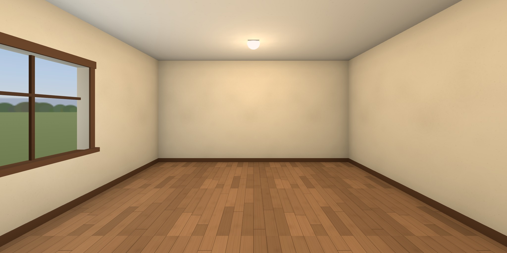

# RoomTemplateEmpty

**https://ariamokr.github.io/RoomTemplateEmpty/**

An empty room behind one of the [Hallway](https://ariamokr.github.io/hallway/)'s doors, made to be
copied: a floor, four walls, a ceiling with its lamps, a window onto the afternoon sky, and the
doorway back to the Hallway. It has everything a room needs and nothing a particular room has, so a
new room starts as a copy of it (below, "Making a room from this template"). Walk it in VR on a
Meta Quest, on a desktop or on a phone. There is nothing to install.



Behind you as you come in is the doorway you came through, glowing, with the Hallway seen through
it. Walk back through it (or click or tap it, or point at it in VR and pull the trigger) and you are
back in the Hallway, in front of this room's door. Beside it, on the wall, is the control panel.

## Moving about

As in the Hallway:

| | Look | Walk | Go back out | Wave (in a shared session) |
|---|---|---|---|---|
| Desktop | drag | WASD or arrows (Shift runs), Q/E or ←/→ turn, click the floor | click the doorway, or walk into it | the **Wave** button |
| Phone | drag | tap the floor | tap the doorway | the **Wave** button |
| Headset | your head | left stick walks (or aims a teleport), right stick turns, trigger at the floor teleports | trigger (or pinch) at the doorway, or step through it | squeeze a grip |
| Gamepad | right stick | left stick (click it in to hurry) | aim the dot at the doorway and press A, or walk into it | the **Wave** button |

The walls stop you. **Fullscreen** and **Enter VR** are at the bottom right. The **control panel**
by the doorway holds Enter or exit VR, how to move and turn in VR (Smooth or Teleport, Snap or
Smooth), the comfort settings below, and Start or Leave shared session. The card at the top left
(the page's navigation) has the same choices as real controls under **Settings**, for a keyboard or
a screen reader, and **← Hallway** as a plain link. The VR choices are the Hallway's own: both read
and keep them in `localStorage` under `hallway.nav` ([AriaMoKr/common](https://github.com/AriaMoKr/common)'s
`nav.js`), so a choice made on either side of the door holds on the other.

### Settings for comfort

Three settings, on the panel and in the card's **Settings**, are shared the same way, under
`hallway.access` (common's `access.js`): set them anywhere on the site and they hold behind every
door.

| Setting | What it does here |
|---|---|
| **Motion**: System, Less or Full | With less motion (System follows the device's own setting) nothing glides: a click on the floor or the doorway is a jump, not a walk; the fades are blinks; the doorway's veil holds still; a waving visitor doesn't bob; and the page's own transitions stop. |
| **Vignette**: On or Off | In VR, while you glide or turn smoothly with the sticks, the edge of the view darkens and closes in, and opens when you stop. Snap turns and teleports blink instead. |
| **Seated**: On or Off | In VR, your view is raised 0.45 m, so sitting down you see the room from about standing height. |

## Coming in through the Hallway's door

The Hallway opens a door's room with the visit added to its address, by the door contract in
[AriaMoKr/common](https://github.com/AriaMoKr/common)'s README ("Going in", "Linking back"), whose
`door.js` the room reads it with. It reads it once and takes it off the address, so a reload, Back
or a shared link doesn't arrive again; `room` stays.

| Parameter | What the room does with it |
|---|---|
| `from=hallway`, `back`, `backname` | The doorway leads back to `back`, called the Hallway when it is the Hallway's own page (or, developing, when both are on this machine); any other address is named by its host, or by `backname`. Without `back`, it leads to the Hallway anyway, at `?from=roomtemplateempty`, in front of this room's door. The way back lasts the tab (`sessionStorage`). |
| `dx`, `yaw`, `pitch` | You come in where you went through (`dx` across the doorway), turned and looking as you were. |
| `dw`, `dh`, `glow` | The doorway is that wide and high, and glows in that colour. |
| `room` | You stay in the shared session (below); the doorway back carries it on. |

Walking in from the Hallway's VR, Quest Browser can hand this page the immersive session without a
click (`sessiongranted`): the room listens for it from the first script on the page and takes it at
once, so you stay in VR, as long as both are on `ariamokr.github.io`.

Through the doorway you see the Hallway: the view it publishes out of its door to here
(`views/views.json` beside the Hallway, under this room's id; common's README, "The view from your
door"). Until the Hallway has a door to here and has published that view, and whenever the way back
is not the Hallway, the doorway shows its glow and the name of where it leads.

## Together

The Hallway's shared session ([AriaMoKr/layersharedsession](https://github.com/AriaMoKr/layersharedsession),
peer to peer over WebRTC) comes in here too. Come in from the Hallway in a session and you join the
same room here, as `roomtemplateempty`; the others in here are drawn by the layer's avatars.
**Start shared session**, on the panel or in the card, starts one here; **Copy invite link** copies
its address, and **Wave** (or a grip in VR) waves to everyone in it. The doorway back carries the
session into the Hallway.

## Running it

You need Node.js 22 or newer.

```bash
npm install       # three.js, common, the shared-session layer, Trystero and IWER, copied into public/vendor/ by common's tools/vendor.mjs from vendor.json
npm start         # http://localhost:8094/
npm test          # node --test: the config, where you may walk, the way back's address, the vendor list, the page
npm run preview   # public/hallway-preview.jpg and public/social.jpg, in headless Chrome
```

`public/` is the whole site: any static server can serve it once `npm install` has filled
`public/vendor/`. `?xr=emulate` installs Meta's IWER emulator (a virtual Quest 3). For a Quest over
adb, `adb reverse tcp:8094 tcp:8094` and start the server on IPv4 (`npm start -- --host 127.0.0.1`).

To try the way in and out locally, serve the Hallway's checkout as well (on 8088) and open the room
as its door would:

```
http://localhost:8094/?from=hallway&back=http%3A%2F%2Flocalhost%3A8088%2F%3Ffrom%3Droomtemplateempty&dx=0.2&yaw=-15&pitch=-5&dw=1.1&dh=2.25&glow=7fb4d6
```

## The pictures

`npm run preview` (`tools/preview.mjs`) renders two pictures in headless Chrome, and they are
committed:

- `public/hallway-preview.jpg`, 2048 × 1024: the room from where one arrives, at eye height, facing
  in, hung as the Hallway hangs its doorways' pictures. The Hallway's doorway to here shows it.
- `public/social.jpg`, 1280 × 640: the room from across it, looking back at the doorway and the
  window. The page's `og:image` and `twitter:image` show it.

Render them again whenever the room changes. Chrome starts through common's `tools/chrome.mjs`, on a
new profile that is first told the Windows password is not blank, so it never tries a logon to find
out. Never start Chrome for these by hand on a new profile.

## Making a room from this template

On GitHub, **Use this template** → **Create a new repository** (or clone it and push to a new
repository), then:

1. **The config.** Edit [`public/js/config.js`](public/js/config.js), the one module a room
   changes: its `id` (its door's id in the Hallway, lower case, 1–32 of a–z, 0–9 and -), `title`,
   `description`, `sign`, `url` (`https://ariamokr.github.io/<repository>/`), `size`, `colors`, the
   `window`'s wall and the sky's `skyYaw` (common's README, "A room's yaw"), the dev server's `port`
   (clear of the other sites' ports), and the doorway's `glow`. Then make the room your own in the
   rest of `public/js/`.
2. **package.json's name**: the new `id`, and its `description`, `homepage` and `repository` to
   match.
3. **index.html**: the `<title>`, the `<meta name="description">` (word for word the config's
   `description`), the `og:` and `twitter:` tags (absolute URLs at the new address), the image's
   `alt`, and the `<noscript>` heading and link (`?from=<id>`). `npm test` checks they match the
   config.
4. **The port**: the config's `port`, and `.claude/launch.json`'s.
5. **The pictures retaken**: `npm run preview`, then look at both and commit them.
6. **README.md and CLAUDE.md**: say what the new room is.
7. **Pages switched on**: Settings → Pages → Source: GitHub Actions (or
   `gh api -X POST repos/<owner>/<repository>/pages -f build_type=workflow`), then push to `main`;
   and upload `public/social.jpg` as the repository's social preview (Settings → General) by hand.
8. **The Hallway's door added**: an entry in the Hallway's
   [`public/js/environments.js`](https://github.com/AriaMoKr/hallway/blob/main/public/js/environments.js),
   the config's `hallwayDoor()` (below); then the Hallway renders its `views/` again, so the doorway
   back here shows the hall.

This template's own door entry, which the Hallway does not have (it is a template, not a room):

```js
{
  id: 'roomtemplateempty',
  title: 'RoomTemplateEmpty',
  subtitle: "An empty room behind one of the Hallway's doors, made to be copied: a floor, four walls, a ceiling, a window onto the afternoon sky, and the doorway back. Walk it in VR on a Meta Quest, on a desktop or on a phone.",
  sign: 'Room',
  url: 'https://ariamokr.github.io/RoomTemplateEmpty/',
  preview: 'https://ariamokr.github.io/RoomTemplateEmpty/hallway-preview.jpg',
  color: '#7fb4d6',
},
```

As the Hallway's README asks ("Adding a door"), the title on the plaque by the door is the
repository's name and the subtitle is the page's description word for word.

## Publishing

`.github/workflows/pages.yml` publishes `public/` to GitHub Pages on every push to `main`, after
the tests, through the sites' workflow in [AriaMoKr/common](https://github.com/AriaMoKr/common)
(`v0.5.0`, on Node 24). Every URL in the page is relative, so it works under any repository's path.

## License

[MIT](LICENSE).
